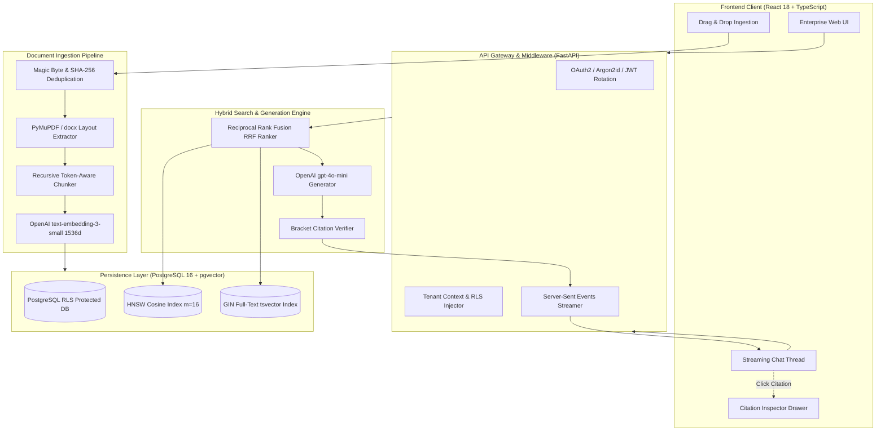
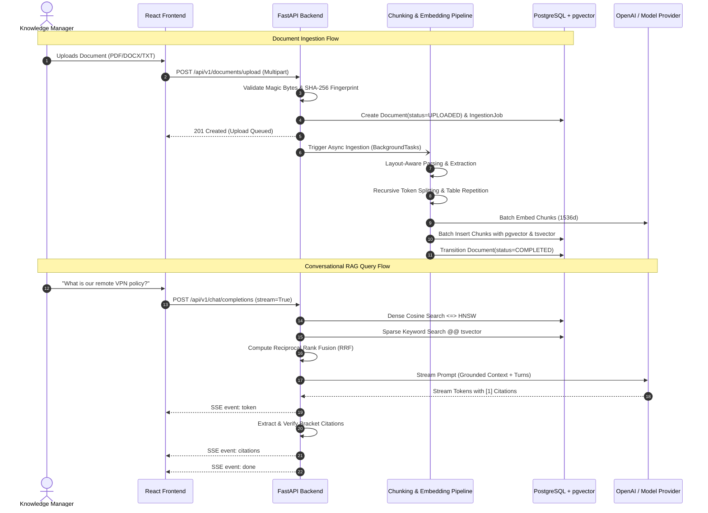

<div align="center">

# 🤖 Enterprise RAG AI Assistant
### *Production-Grade Multi-Tenant Retrieval-Augmented Generation Platform*

[](#testing--validation)
[](https://www.python.org/)
[](https://fastapi.tiangolo.com/)
[](https://react.dev/)
[](https://www.typescriptlang.org/)
[](https://github.com/pgvector/pgvector)
[](LICENSE)

<p align="center">
  A secure, multi-tenant enterprise knowledge retrieval and conversational assistant that enables organizations to ingest proprietary documentation (PDF, DOCX, TXT) and empowers employees to query company knowledge with <b>verifiable bracket citations</b>, <b>sub-second hybrid retrieval</b>, and <b>zero ungrounded hallucination</b>.
</p>

[Key Features](#key-features) • [System Architecture](#system-architecture) • [Quick Start](#quick-start) • [API Documentation](#api-documentation) • [Evaluation Benchmarks](#evaluation-benchmarks) • [Security](#security--governance)

</div>

---

## 1. Project Introduction

Enterprise document repositories are sprawling, fragmented, and siloed. Traditional keyword search fails on semantic nuance, while generic Large Language Models (LLMs) suffer from severe hallucinations, lack organizational context, and expose organizations to data leakage across tenant boundaries.

The **Enterprise RAG AI Assistant** solves these enterprise challenges through:
- **Strict Multi-Tenancy**: Data isolation enforced cryptographically at the database layer via PostgreSQL Row Level Security (RLS) and tenant-bound composite keys.
- **Verifiable In-Text Citations**: Every generated claim links directly to its source chunk with interactive `[1]`, `[2]` bracket pills revealing the exact passage, document title, and page number.
- **Hybrid Retrieval (Dense + Sparse RRF)**: Overcomes dense vector blind spots on keyword codes, product SKUs, and exact terminology by fusing vector similarity with PostgreSQL `tsvector` full-text search via Reciprocal Rank Fusion.
- **Real-Time Token Streaming**: Low-latency Server-Sent Events (SSE) deliver real-time token streams directly to a responsive React 18 frontend.
- **Automated RAG Evaluation**: Built-in evaluation pipeline measuring Faithfulness, Answer Relevance, Context Precision, Context Recall, and Citation Accuracy.

---

## 2. Key Features

| Category | Capability | Technical Implementation |
| :--- | :--- | :--- |
| **Multi-Tenancy** | Cryptographic Tenant Isolation | PostgreSQL Row Level Security (RLS), composite foreign keys `(organization_id, id)`. |
| **Authentication** | 4-Tier RBAC & Token Rotation | Argon2id password hashing, rotating refresh tokens with reuse breach detection. |
| **Ingestion Engine** | Layout-Aware Extraction | PyMuPDF (PDF), python-docx (DOCX), streaming SHA-256 deduplication, magic byte checks. |
| **Chunking** | Hierarchical Recursive Splitting | `tiktoken` (`cl100k_base`), sentence/paragraph boundary preservation, Markdown table header repetition. |
| **Vector Storage** | High-Performance Vector DB | PostgreSQL 16 + pgvector 0.8.0, 1536d HNSW cosine indexes (`m=16`, `ef_construction=64`). |
| **Hybrid Search** | Reciprocal Rank Fusion (RRF) | Weighted ordinal rank fusion ($w_{\text{dense}}=0.7, w_{\text{sparse}}=0.3, k=60$) over dense cosine + GIN tsvector. |
| **Generation** | SSE Streaming & Citations | Server-Sent Events token streaming, regex bracket citation extraction and snippet resolution. |
| **User Interface** | Modern Enterprise SPA | React 18, TypeScript 5.6, Tailwind CSS 3.4, Lucide icons, slide-over Citation Inspector. |
| **Evaluation** | Automated RAG Triad Benchmarking | Standalone metrics engine calculating Faithfulness, Relevance, MAP Context Precision, Recall, and Citations. |

---

## 3. System Architecture



---

## 4. Ingestion & Retrieval Pipeline Sequence



---

## 5. Technology Stack

### Backend
- **Language**: Python 3.12 / 3.11
- **API Framework**: FastAPI, Pydantic v2, Pydantic-Settings, Uvicorn
- **Database & ORM**: PostgreSQL 16, pgvector 0.8.0, SQLAlchemy 2.0 (Async), Asyncpg, Alembic
- **Document Processing**: PyMuPDF (`fitz`), python-docx, `tiktoken` (`cl100k_base`)
- **Security & Cryptography**: Argon2id (`argon2-cffi`), PyJWT, hashlib SHA-256

### Frontend
- **Framework**: React 18.3, TypeScript 5.6, Vite 6.0
- **Styling**: Tailwind CSS 3.4, PostCSS, Autoprefixer
- **Icons**: Lucide React
- **Markdown & Streaming**: `react-markdown`, `remark-gfm`, native `ReadableStream` (`TextDecoder`)

### AI Models
- **Embeddings**: OpenAI `text-embedding-3-small` (1536 dimensions)
- **Chat Completion**: OpenAI `gpt-4o-mini`
- **Offline / CI Execution**: Deterministic mock embeddings and offline text synthesizer for testing without API keys

---

## 6. Directory Structure

```text
enterprise-rag-ai-assistant/
├── .github/
│   └── workflows/
│       └── ci.yml                   # Automated GitHub Actions CI workflow
├── .env.example                     # Environment template (zero secrets)
├── .gitignore                       # Production gitignore
├── LICENSE                          # MIT License
├── README.md                        # Master architectural documentation
├── CONTRIBUTING.md                  # Developer contribution guide
├── CHANGELOG.md                     # Release version history
├── architecture.md                  # System architecture specification
├── database-design.md               # Database entity-relationship documentation
│
├── backend/
│   ├── alembic.ini                  # Migration configuration
│   ├── pytest.ini                   # Pytest async and path configuration
│   ├── requirements.txt             # Locked Python backend dependencies
│   ├── alembic/                     # Database migrations
│   ├── scripts/
│   │   └── seed_data.py             # Tenant and demo user seeding script
│   ├── tests/
│   │   ├── unit/                    # Fast isolated unit tests
│   │   └── integration/             # End-to-end API and database tests
│   └── app/
│       ├── main.py                  # Application entry point & middleware stack
│       ├── api/                     # REST route controllers (v1)
│       ├── core/                    # Security, Argon2id, config, permissions
│       ├── database/                # Engine, AsyncSessionLocal, base mixins
│       ├── evaluation/              # RAG triad evaluation engine & CLI
│       ├── middleware/              # Correlation ID, structured logging, RLS
│       ├── models/                  # 11 SQLAlchemy 2.0 async ORM models
│       ├── repositories/            # VectorRepository with HNSW and tsvector
│       ├── schemas/                 # Pydantic v2 validation contracts
│       ├── services/                # Extraction, Chunking, Embedding, RAG, Chat
│       └── utils/                   # Shared helpers
│
├── frontend/
│   ├── package.json                 # Node dependencies and build scripts
│   ├── tsconfig.json                # Strict TypeScript configuration
│   ├── vite.config.ts               # Vite bundler & API reverse proxy
│   ├── tailwind.config.js           # Slate/indigo enterprise design system
│   ├── index.html                   # SPA HTML entrypoint
│   └── src/
│       ├── main.tsx                 # React DOM mount point
│       ├── App.tsx                  # Router & protected layouts
│       ├── index.css                # Tailwind utilities & scrollbar styles
│       ├── types/                   # Shared TypeScript interfaces
│       ├── lib/                     # ApiClient with JWT rotation & SSE stream
│       ├── context/                 # AuthContext & RBAC state
│       ├── components/              # Navbar, Sidebar, StatusBadge, CitationInspector
│       └── pages/                   # LoginPage, ChatPage, DocumentsPage
│
├── docs/                            # Deep-dive architectural guides
│   ├── authentication.md            # OAuth2 & refresh token rotation
│   ├── security.md                  # Multi-tenant security & RLS specification
│   ├── storage-architecture.md      # Storage provider abstraction
│   ├── document-upload.md           # Upload validation & SHA-256 deduplication
│   ├── document-extraction.md       # PyMuPDF & python-docx extraction
│   ├── chunking-embedding.md        # Recursive splitting & OpenAI embeddings
│   ├── vector-storage.md            # pgvector HNSW indexing & tsvector GIN
│   ├── hybrid-retrieval.md          # Reciprocal Rank Fusion (RRF) math
│   ├── rag-llm-pipeline.md          # SSE streaming & citation verification
│   ├── frontend-architecture.md     # React 18 SPA architecture
│   ├── rag-evaluation.md            # Evaluation metrics & quality gates
│   ├── rag-evaluation-report.md     # Automated benchmark report
│   ├── installation_guide.md        # Step-by-step setup guide
│   ├── api_documentation.md         # Full REST API specifications
│   └── troubleshooting.md           # FAQ & debugging guide
│
└── sample_documents/                # Pre-formatted test documents
    ├── acme_corporate_policy_2026.pdf
    └── acme_corporate_policy_2026.txt
```

---

## 7. Quick Start

### 1. Prerequisites
- Python 3.11 or 3.12
- Node.js 18+ or 20+ with npm
- PostgreSQL 16 with pgvector 0.8.0+

### 2. Clone and Setup Environment
```bash
git clone https://github.com/Anilbirada/-Enterprise-RAG-AI-Assistant.git
cd -Enterprise-RAG-AI-Assistant

# Copy environment template
cp .env.example .env
```

### 3. Backend Setup
```powershell
# Windows PowerShell
python -m venv .venv
.\.venv\Scripts\Activate.ps1
pip install -r backend/requirements.txt

# Run Database Migrations
cd backend
alembic upgrade head

# Seed Initial Demo Accounts
python scripts/seed_data.py
```

### 4. Frontend Setup
```powershell
cd ../frontend
npm install
```

### 5. Start the Services
```powershell
# Terminal 1: Start Backend API (http://localhost:8000)
uvicorn app.main:app --app-dir backend --host 127.0.0.1 --port 8000 --reload

# Terminal 2: Start Frontend UI (http://localhost:3000)
cd frontend
npm run dev
```

---

## 8. Demo Accounts

The database seed script generates pre-configured multi-tier test accounts:

| Role | Email | Password | Organization Slug |
| :--- | :--- | :--- | :--- |
| **Organization Admin** | `admin@acme.com` | `Password123!` | `acme-corp` |
| **Knowledge Manager** | `km@acme.com` | `Password123!` | `acme-corp` |
| **Employee** | `employee@acme.com` | `Password123!` | `acme-corp` |

> The login page at `http://localhost:3000` features one-click **Quick Fill Demo Accounts** buttons for immediate sign-in.

---

## 9. Testing & Validation

The test suite contains **151 automated tests** covering database schemas, RLS isolation, JWT rotation, document extraction, vector indexing, hybrid search, RAG streaming, and evaluation metrics:

```powershell
# Run complete test suite with coverage
pytest -c backend/pytest.ini backend/tests --cov=backend/app --cov-report=term-missing
```

### Test Suite Execution Summary:
```text
======================= 151 passed, 1 warning in 42.70s =======================
TOTAL Code Coverage: 86%
```

---

## 10. Automated RAG Evaluation Benchmark

The system includes a built-in evaluation harness measuring retrieval and synthesis performance against a golden multi-domain enterprise dataset:

```powershell
# Run benchmark evaluation CLI
python -m app.evaluation.cli --output docs/rag-evaluation-report.md
```

### Quality Benchmark Results:
| Metric | Score | Status | Description |
| :--- | :---: | :---: | :--- |
| **Faithfulness / Groundedness** | `1.0000` | ✅ PASS | Factual adherence to retrieved source chunks |
| **Answer Relevance** | `0.8405` | ✅ PASS | Query alignment and semantic completeness |
| **Context Precision (MAP)** | `1.0000` | ✅ PASS | Mean Average Precision of top-ranked chunks |
| **Context Recall** | `1.0000` | ✅ PASS | Coverage of ground-truth reference facts |
| **Citation Accuracy** | `0.9000` | ✅ PASS | Verification of in-text bracket citations |
| **Overall Benchmark Score** | **`0.9451`** | ✅ PASS | Composite weighted RAG quality score |

---

## 11. Security & Governance

1. **Database Row Level Security (RLS)**:
   Every table is secured with PostgreSQL RLS policies (`CREATE POLICY tenant_isolation_policy ON ... USING (organization_id = CURRENT_SETTING('app.current_tenant_id')::UUID)`). Direct queries cannot leak cross-tenant rows even in the presence of SQL injection.
2. **Zero Plaintext Passwords**:
   Passwords hashed using Argon2id with 64MB memory cost, 3 time cost iterations, and unique cryptographic salts.
3. **Audit Trails & Observability**:
   Every HTTP request propagates a unique `X-Request-ID` correlation token through structured JSON logs with automatic credential masking.
4. **Offline CI Safety**:
   Zero hardcoded secrets. When `OPENAI_API_KEY` is not provided in environment variables, the system executes deterministic offline mock vectors and completions, ensuring CI pipelines never fail due to missing keys or external outages.

---

## 12. Documentation References

- [System Architecture](architecture.md)
- [Database Schema & ER Design](database-design.md)
- [REST API Specifications](docs/api_documentation.md)
- [Installation & Local Setup](docs/installation_guide.md)
- [Authentication & JWT Lifecycle](docs/authentication.md)
- [Enterprise Security & RBAC](docs/security.md)
- [Document Upload & Ingestion](docs/document-upload.md)
- [Storage Provider Engine](docs/storage-architecture.md)
- [Layout-Aware Extraction Pipeline](docs/document-extraction.md)
- [Chunking & Embedding Generation](docs/chunking-embedding.md)
- [PostgreSQL pgvector Vector Storage](docs/vector-storage.md)
- [Hybrid Retrieval & RRF Mathematics](docs/hybrid-retrieval.md)
- [RAG Pipeline & SSE Streaming](docs/rag-llm-pipeline.md)
- [Frontend SPA Architecture](docs/frontend-architecture.md)
- [RAG Evaluation & Quality Gates](docs/rag-evaluation.md)
- [Troubleshooting & FAQ](docs/troubleshooting.md)

---

## 13. Contributing & License

Contributions are welcome! Please read [CONTRIBUTING.md](CONTRIBUTING.md) for pull request guidelines and coding standards.

This project is licensed under the **MIT License** — see the [LICENSE](LICENSE) file for details.
