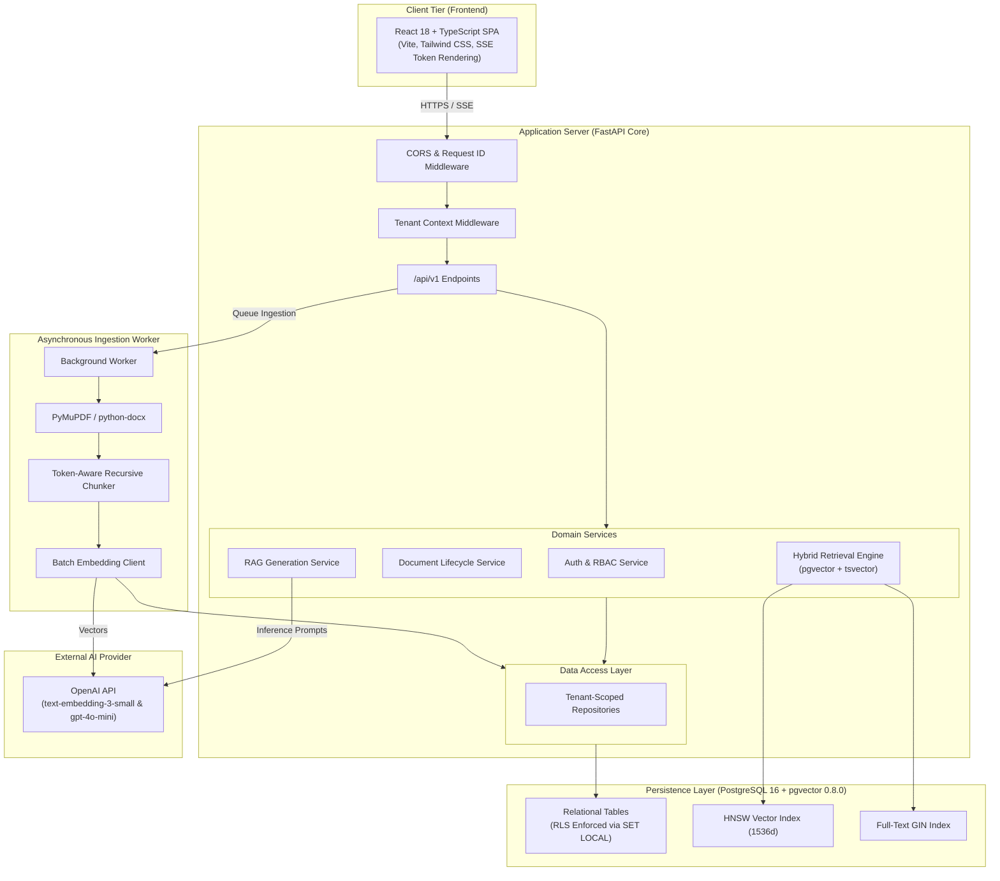

# Enterprise RAG AI Assistant - System Architecture

## 1. High-Level Architecture Overview

The **Enterprise RAG AI Assistant** is an enterprise-grade retrieval-augmented generation platform providing grounded, citation-backed answers over internal corporate documents.



---

## 2. Multi-Tenant Security & Defense-in-Depth

1. **Authentication Token Binding:** The verified JWT payload injects immutable tenant identity (`org_id`).
2. **Transaction-Local Database Context:** Every async connection executes:
   ```sql
   SELECT set_config('app.current_org_id', :org_id, true);
   ```
3. **PostgreSQL Row Level Security (RLS):** Non-superuser application roles (`rag_app_user`) cannot read or write rows with mismatched `organization_id`.
4. **Composite Foreign Keys:** Child entities cannot reference parent entities from foreign organizations.
5. **Pre-Filtered Retrieval:** Vector similarity search executes with an explicit `organization_id = :org_id` predicate, preventing unauthorized cross-department data exposure.

---

## 3. Technology Stack Reference

- **Backend:** Python 3.12, FastAPI, Pydantic Settings, Uvicorn
- **ORM & Migrations:** SQLAlchemy 2.0 (Async), Asyncpg, Alembic
- **Database:** PostgreSQL 16 with pgvector 0.8.0
- **Document Processing (Phases 5-7):** PyMuPDF (`fitz`), `python-docx`, TikToken
- **Embeddings:** OpenAI `text-embedding-3-small` (1536 dimensions)
- **Frontend (Phase 11):** React 18, TypeScript, Vite, Tailwind CSS
- **Testing:** Pytest, pytest-asyncio, pytest-cov, HTTPX
