# Database Architecture & Security Design

## 1. Overview
The **Enterprise RAG AI Assistant** database is built on **PostgreSQL 16** with the **pgvector 0.8.0** extension. It unifies relational business domain data, document version history, asynchronous processing jobs, conversation sessions, user feedback, and dense 1536-dimensional vector embeddings within an ACID-compliant engine.

---

## 2. Entity-Relationship Diagram

```mermaid
erDiagram
    ORGANIZATIONS ||--o{ USERS : "employs"
    ORGANIZATIONS ||--o{ DEPARTMENTS : "contains"
    ORGANIZATIONS ||--o{ DOCUMENTS : "owns"
    ORGANIZATIONS ||--o{ CONVERSATIONS : "contains"
    ORGANIZATIONS ||--o{ INGESTION_JOBS : "tracks"
    
    DEPARTMENTS ||--o{ USERS : "assigns"
    DEPARTMENTS ||--o{ DOCUMENTS : "restricts"

    USERS ||--o{ DOCUMENTS : "uploads"
    USERS ||--o{ DOCUMENT_VERSIONS : "authors"
    USERS ||--o{ CONVERSATIONS : "initiates"
    USERS ||--o{ FEEDBACK : "submits"
    
    DOCUMENTS ||--o{ DOCUMENT_VERSIONS : "composite (org_id, doc_id)"
    DOCUMENTS ||--o{ DOCUMENT_CHUNKS : "composite (org_id, doc_id)"
    DOCUMENTS ||--o{ INGESTION_JOBS : "composite (org_id, doc_id)"
    
    DOCUMENT_VERSIONS ||--o{ DOCUMENT_CHUNKS : "composite (org_id, ver_id)"

    CONVERSATIONS ||--o{ MESSAGES : "composite (org_id, conv_id)"
    MESSAGES ||--o{ MESSAGE_CITATIONS : "composite (org_id, msg_id)"
    MESSAGES ||--o{ FEEDBACK : "composite (org_id, msg_id)"

    DOCUMENT_CHUNKS ||--o{ MESSAGE_CITATIONS : "composite (org_id, chunk_id)"

    ORGANIZATIONS {
        uuid id PK
        varchar_120 name
        varchar_60 slug UK
        jsonb settings
        boolean is_active
        timestamp created_at
        timestamp updated_at
    }

    DEPARTMENTS {
        uuid id PK
        uuid organization_id FK
        varchar_100 name
        varchar_50 code
        timestamp created_at
        timestamp updated_at
    }

    USERS {
        uuid id PK
        uuid organization_id FK
        uuid department_id FK
        varchar_255 email
        varchar_255 hashed_password
        varchar_120 full_name
        varchar_30 role
        boolean is_active
        timestamp last_login_at
        timestamp created_at
        timestamp updated_at
    }

    DOCUMENTS {
        uuid id PK
        uuid organization_id FK
        uuid department_id FK
        uuid uploaded_by_id FK
        varchar_255 title
        varchar_255 file_name
        varchar_500 file_path
        varchar_50 file_type
        varchar_64 file_hash
        integer file_size_bytes
        varchar_30 status
        uuid current_version_id
        jsonb metadata
        timestamp created_at
        timestamp updated_at
    }

    DOCUMENT_VERSIONS {
        uuid id PK
        uuid organization_id FK
        uuid document_id FK
        integer version_number
        varchar_500 file_path
        varchar_64 file_hash
        integer file_size_bytes
        boolean is_active
        text change_summary
        uuid created_by_id FK
        jsonb metadata
        timestamp created_at
        timestamp updated_at
    }

    DOCUMENT_CHUNKS {
        uuid id PK
        uuid organization_id FK
        uuid document_id FK
        uuid version_id FK
        integer chunk_index
        text content
        integer token_count
        boolean is_active
        vector_1536 embedding
        tsvector search_vector
        jsonb metadata
        timestamp created_at
        timestamp updated_at
    }

    CONVERSATIONS {
        uuid id PK
        uuid organization_id FK
        uuid user_id FK
        varchar_255 title
        boolean is_archived
        timestamp created_at
        timestamp updated_at
    }

    MESSAGES {
        uuid id PK
        uuid organization_id FK
        uuid conversation_id FK
        varchar_20 role
        text content
        integer prompt_tokens
        integer completion_tokens
        float latency_ms
        jsonb model_parameters
        timestamp created_at
        timestamp updated_at
    }

    MESSAGE_CITATIONS {
        uuid id PK
        uuid organization_id FK
        uuid message_id FK
        uuid chunk_id FK
        float relevance_score
        integer rank_position
        text snippet
        timestamp created_at
        timestamp updated_at
    }

    FEEDBACK {
        uuid id PK
        uuid organization_id FK
        uuid message_id FK
        uuid user_id FK
        smallint rating
        text feedback_text
        jsonb tags
        timestamp created_at
        timestamp updated_at
    }

    INGESTION_JOBS {
        uuid id PK
        uuid organization_id FK
        uuid document_id FK
        uuid version_id
        varchar_120 idempotency_key UK
        varchar_30 status
        integer priority
        integer retry_count
        integer max_retries
        text error_message
        jsonb error_details
        integer progress_percent
        varchar_100 worker_id
        timestamp started_at
        timestamp completed_at
        timestamp heartbeat_at
        timestamp created_at
        timestamp updated_at
    }
```



---

## 3. Multi-Tenant Security & Composite Foreign Keys

### Composite Foreign Key Enforcement
To prevent cross-tenant entity references (e.g. associating an Organization A chunk with an Organization B document), child tables enforce composite foreign keys matching parent `(organization_id, id)` constraints:

```sql
ALTER TABLE document_chunks
ADD CONSTRAINT fk_chunks_org_document
FOREIGN KEY (organization_id, document_id)
REFERENCES documents(organization_id, id)
ON DELETE CASCADE;

ALTER TABLE document_chunks
ADD CONSTRAINT fk_chunks_org_version
FOREIGN KEY (organization_id, version_id)
REFERENCES document_versions(organization_id, id)
ON DELETE CASCADE;
```

### PostgreSQL Row Level Security (RLS)
1. **Application Role:** Web endpoints execute queries as `rag_app_user`, an unprivileged role without `SUPERUSER` or `BYPASSRLS`.
2. **Session Variable Scoping:** Every transaction initializes the tenant context:
   ```sql
   SELECT set_config('app.current_org_id', :org_id, true);
   ```
   Passing `true` as the third argument restricts the setting strictly to the current transaction. When connection pooling returns the socket, no cross-tenant state leaks.
3. **RLS Policies:**
   ```sql
   CREATE POLICY rls_documents_tenant_isolation ON documents
   FOR ALL
   USING (organization_id = NULLIF(current_setting('app.current_org_id', true), '')::uuid)
   WITH CHECK (organization_id = NULLIF(current_setting('app.current_org_id', true), '')::uuid);
   ```

---

## 4. Vector Database & Indexing Strategy

### Embedding Storage
- **Model:** OpenAI `text-embedding-3-small`
- **Dimensions:** 1536 floats
- **pgvector Column:** `embedding vector(1536) NOT NULL`

### HNSW Indexing
Hierarchical Navigable Small World index configured for fast cosine distance lookups:
```sql
CREATE INDEX idx_chunks_embedding_hnsw ON document_chunks 
USING hnsw (embedding vector_cosine_ops) 
WITH (m = 16, ef_construction = 64);
```
- `m = 16`: Number of bidirectional links established per node.
- `ef_construction = 64`: Size of the dynamic candidate list during graph construction.

### Hybrid Retrieval Indexing
Alongside dense vectors, each chunk maintains a computed full-text search column:
```sql
search_vector tsvector GENERATED ALWAYS AS (to_tsvector('english', content)) STORED;
CREATE INDEX idx_chunks_search_vector ON document_chunks USING GIN(search_vector);
```

---

## 5. Document Versioning & Outdated Chunks Prevention

1. **Version Partitioning:** When a document is modified or re-uploaded with new content, a new `DocumentVersion` record is incremented (`version_number = 2`).
2. **State Flagging:** Outdated version chunks have `is_active = FALSE`. The active version chunks maintain `is_active = TRUE`.
3. **Retrieval Filtering:** All semantic and keyword retrieval queries apply the predicate:
   ```sql
   WHERE organization_id = :org_id AND is_active = TRUE
   ```
   This guarantees that historical chunks remain available for message citation audit trails while preventing outdated policies from polluting current query results.

---

## 6. Durable Ingestion Jobs

The `ingestion_jobs` table provides state persistence for document processing:
- **Idempotency Key:** `uq_jobs_org_idempotency` on `(organization_id, idempotency_key)` prevents double-processing identical upload requests.
- **Lease Heartbeat:** `worker_id` and `heartbeat_at` allow orphaned jobs (crashed workers) to be reclaimed by background workers.
- **Retry Policy:** `retry_count` and `max_retries` with `error_details` capture failure diagnosis.
