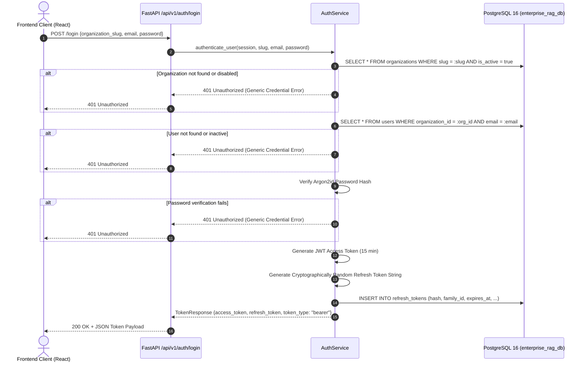
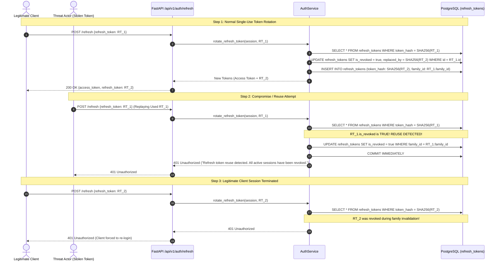

# Enterprise Authentication & Session Architecture

This document specifies the authentication, token lifecycle, and session management architecture implemented in Phase 4 of the Enterprise RAG AI Assistant.

---

## 1. Multi-Tenant Login & Disambiguation

### Architectural Problem: Duplicate Emails Across Organizations
In a multi-tenant enterprise system, a user may hold accounts across multiple distinct tenant organizations using the same email address (e.g., an external consultant or auditor). Consequently, our database schema enforces a composite uniqueness constraint:
```sql
CONSTRAINT uq_users_org_email UNIQUE (organization_id, email)
```
Because the `email` alone is not unique globally, the authentication subsystem must disambiguate the target organization before verifying credentials.

### Login Resolution Workflow
Clients must provide the tenant's human-readable, immutable identifier (`organization_slug`) alongside user credentials:
```json
POST /api/v1/auth/login
{
  "organization_slug": "alpha-corp",
  "email": "employee@example.com",
  "password": "SecurePassword123!"
}
```



> **Security Rule**: To prevent user enumeration attacks across organizations, errors for non-existent organizations, inactive accounts, non-existent users, or mismatched passwords always return identical generic responses:
> ```json
> {
>   "success": false,
>   "error": {
>     "code": "UNAUTHORIZED",
>     "message": "Invalid organization, email, or password.",
>     "request_id": "...",
>     "timestamp": "..."
>   }
> }
> ```

---

## 2. Token Specifications & Claims Structure

### Access Token (JWT)
- **Lifespan**: Short-lived (15 minutes).
- **Signing Algorithm**: HMAC-SHA256 (`HS256`) using dedicated `JWT_SECRET_KEY` (minimum 32 characters).
- **Explicit Claims**:
  - `sub`: Authoritative User UUID string.
  - `org_id`: Organization UUID string.
  - `org_slug`: Organization human-readable slug.
  - `role`: User role (`SUPER_ADMIN`, `ORG_ADMIN`, `KNOWLEDGE_MANAGER`, `EMPLOYEE`).
  - `dept_id`: Optional department UUID string.
  - `iss`: Issuer (`enterprise-rag-api`).
  - `aud`: Audience (`enterprise-rag-client`).
  - `exp`: Expiration timestamp (epoch).
  - `iat`: Issued-at timestamp (epoch).
  - `jti`: Unique token identifier (UUID4).

> **Payload Hygiene**: Passwords, encryption keys, or sensitive PII are never placed inside the JWT claims payload.

### Refresh Token (Opaque Token Family)
- **Lifespan**: Long-lived (7 days).
- **Structure**: 64-character URL-safe cryptographically secure random string (`secrets.token_urlsafe(48)`).
- **Database Persistence**: Stored only as a SHA-256 cryptographic digest (`token_hash`), never in plaintext.
- **Family Tracking**: Every refresh token belongs to a `family_id` (UUID4). When rotated, the successor inherits the parent `family_id`.

---

## 3. Refresh Token Rotation & Automatic Reuse Detection

Refresh Token Rotation ensures that refresh tokens are single-use. If a previously consumed or revoked refresh token is presented, the system immediately flags compromise and invalidates the entire token family.

### Normal Rotation vs. Compromise Detection Workflow



---

## 4. Session Revocation & Logout

During explicit logout:
1. Client submits `POST /api/v1/auth/logout` with its current refresh token.
2. The refresh token record in PostgreSQL is flagged with `is_revoked = true` and `revoked_at = NOW()`.
3. Subsequent refresh attempts fail immediately with 401 Unauthorized.
4. The short-lived access token expires within 15 minutes, cleanly terminating access.
