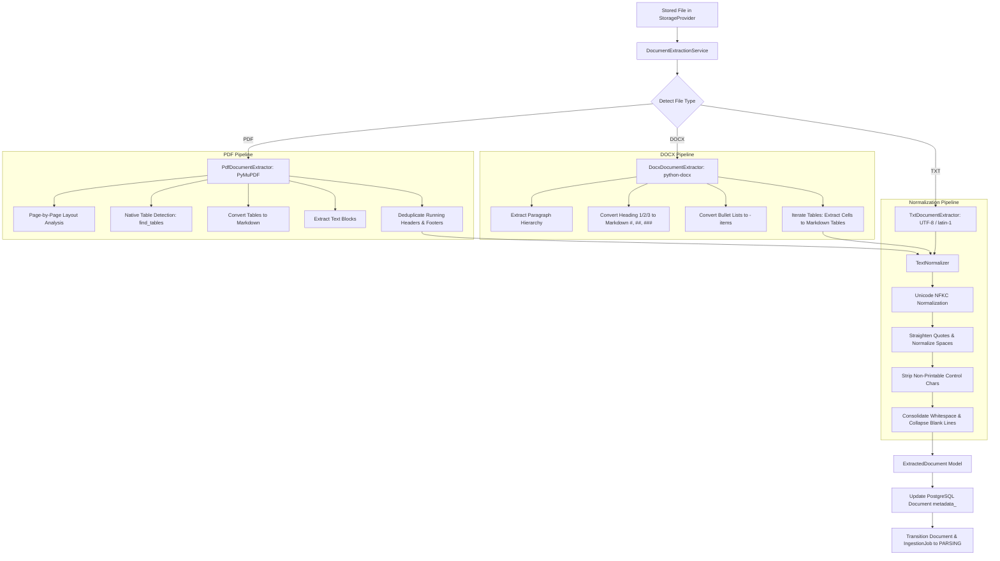

# Document Extraction & Text Processing Pipeline

This document specifies the document extraction, text normalization, and structural preservation architecture implemented in Phase 6 of the Enterprise RAG AI Assistant.

---

## 1. Extraction Pipeline Architecture

The extraction pipeline takes raw document bytes persisted in the storage engine and produces clean, layout-aware, structured text and tables ready for semantic chunking and embedding generation.



---

## 2. Format-Specific Extractors

### 1. PDF Extractor (`PdfDocumentExtractor`)
- **Engine**: PyMuPDF (`pymupdf`), executing inside an asynchronous thread worker pool (`asyncio.to_thread`) to prevent blocking the FastAPI event loop.
- **Page-by-Page Extraction**:
  - Processes each page independently, preserving `page_number`, `width`, and `height`.
  - Enables page-level source attribution so the RAG assistant can cite exact page numbers (e.g., *"Architecture Guide, Page 3"*).
- **Native Table Detection**:
  - Uses PyMuPDF's `page.find_tables()` to detect grid boundaries, row structures, and header cells.
  - Converts detected tables into GitHub Flavored Markdown (GFM) tables.
  - Appends formatted Markdown tables directly into the page's text flow, ensuring embedding models capture dense tabular facts.
- **Header & Footer De-duplication**:
  - Analyzes the top and bottom lines across all pages.
  - Lines appearing on $\ge 70\%$ of pages (such as `"COMPANY CONFIDENTIAL"` or `"Page X of Y"`) are de-duplicated so they do not artificially skew vector embeddings.

### 2. DOCX Extractor (`DocxDocumentExtractor`)
- **Engine**: `python-docx` for XML parsing of OpenXML Word packages.
- **Hierarchy Preservation**:
  - Standard styles are mapped to Markdown markup:
    - `Heading 1` / `Title` $\to$ `# Heading`
    - `Heading 2` $\to$ `## Subheading`
    - `Heading 3` $\to$ `### Section`
    - `List Bullet` / `List Number` $\to$ `- Item`
- **Table Extraction**:
  - Iterates `doc.tables`, extracting each row and cell.
  - Formats tables into Markdown tables with headers and separators.
  - Preserves tabular context for financial statements, technical specifications, and policy tables.

### 3. Plain Text Extractor (`TxtDocumentExtractor`)
- Decodes text with standard UTF-8.
- Falls back to `latin-1` with replacement characters if invalid UTF-8 bytes are encountered.
- Normalizes whitespace and line breaks.

---

## 3. Text Normalization Standards

| Pipeline Step | Standard | Purpose |
| :--- | :--- | :--- |
| **Unicode Normalization** | `unicodedata.normalize("NFKC", text)` | Resolves compatibility characters, ligatures ($\text{fi} \to \text{f}\text{i}$), and full-width symbols. |
| **Punctuation Normalization** | Curly quotes to straight quotes (`“ ” ‘ ’` $\to$ `" '`) | Eliminates tokenizer discrepancies during semantic embedding and keyword BM25 search. |
| **Control Character Stripping** | Regex: `[\x00-\x08\x0b\x0c\x0e-\x1f\x7f-\x9f]` | Removes unprintable control characters while preserving `\n` and `\t`. |
| **Whitespace Consolidation** | `re.sub(r"[ \t]+", " ", text)` | Replaces runs of tabs and spaces with single spaces. |
| **Newline Reduction** | `re.sub(r"\n{3,}", "\n\n", text)` | Replaces excessive blank lines with paragraph breaks (2 newlines). |

---

## 4. Extraction Data Models (`ExtractedDocument`)

Every extractor outputs a standardized Pydantic model:
```python
class ExtractedDocument(BaseModel):
    document_id: Optional[UUID]
    file_type: str              # "PDF", "DOCX", "TXT"
    file_name: str
    full_text: str              # Concatenated, clean text
    pages: List[ExtractedPage]  # Page text, tables, metadata
    tables: List[ExtractedTable]# All extracted Markdown tables
    metadata: Dict[str, Any]    # total_pages, total_words, total_chars
```

---

## 5. Lifecycle Status & Error Resilience

When `DocumentExtractionService.process_document_extraction()` runs:
1. **Transition to PARSING**: Both `Document.status` and `IngestionJob.status` are set to `"PARSING"`.
2. **Metadata Enrichment**: `Document.metadata_` is enriched with:
   - `page_count`
   - `word_count`
   - `character_count`
   - `table_count`
3. **Failure Isolation**: If a document is corrupted, password-protected, or unparseable:
   - `Document.status` transitions to `"FAILED"` with `error_message`.
   - `IngestionJob.status` transitions to `"FAILED"` with `error_message`.
   - The error is isolated; worker threads do not crash.
