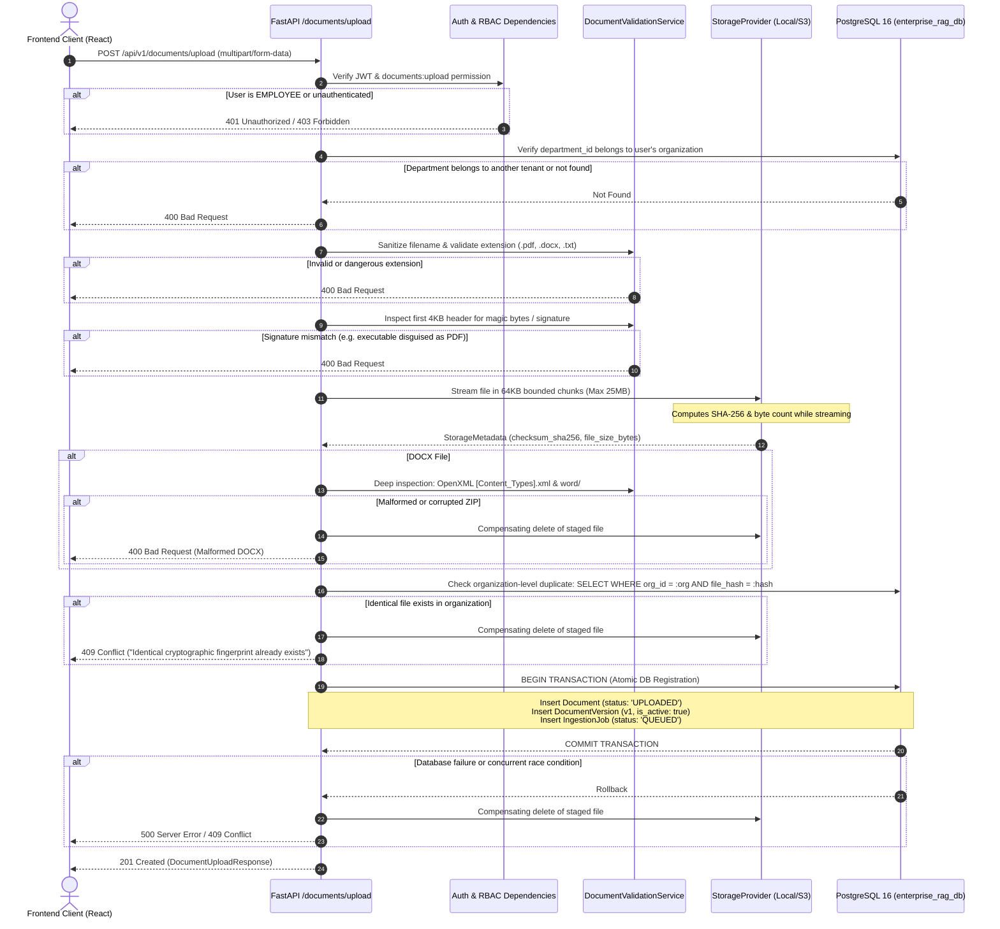

# Document Upload & Ingestion Staging Architecture

This document specifies the document upload, validation, cryptographic deduplication, and atomic staging pipeline implemented in Phase 5 of the Enterprise RAG AI Assistant.

---

## 1. Document Upload Workflow

The document upload process handles incoming file streams with bounded memory usage, enforces organizational ownership and multi-level security validations, prevents duplicate uploads, stages files into the storage provider, and atomically registers records in PostgreSQL 16.



---

## 2. File Validation & Security Engine

### 1. File Extension & Path Sanitization
- Filenames sent by user clients can be hostile (e.g. `../../etc/passwd.pdf`, `.env`, control characters, Unicode confusable homoglyphs).
- The sanitization routine:
  1. Strips all leading directory components using both POSIX and Windows separators.
  2. Disallows hidden files (prepending `uploaded_` if filename starts with a period).
  3. Removes ASCII control characters, null bytes (`\x00`), and non-printable sequences.
  4. Restricts the base name stem to alphanumeric characters, underscores, and hyphens (`[a-zA-Z0-9_\-]`).
  5. Enforces a supported extension allowlist: `.pdf`, `.docx`, `.txt`.

### 2. Magic Signature / Header Sniffing (Do Not Trust MIME Type)
Browsers send `Content-Type` headers based on client-side file extensions, which are easily spoofed by malicious actors. Our validation engine reads the initial 4,096 bytes and enforces real file signatures:
- **PDF**: Must begin with standard magic sequence `b"%PDF-"`.
- **DOCX**: Must begin with PK zip header `b"PK\x03\x04"`. Furthermore, deep inspection unpacks the central directory in memory to verify standard OpenXML structures (`[Content_Types].xml` or `word/`). Disguised or renamed arbitrary `.zip` files are instantly rejected.
- **TXT**: Verified as clean UTF-8 plain text with zero binary null bytes (`\x00`).

### 3. Size Limits & Bounded Memory Streaming
- To prevent Denial of Service (DoS) attacks via memory exhaustion, files are **never loaded into application RAM in their entirety**.
- Uploads are processed as an asynchronous chunked stream (64 KiB chunks).
- Cumulative bytes are calculated on-the-fly. If an upload exceeds `MAX_UPLOAD_FILE_SIZE_BYTES` (default 25 MB), the stream aborts immediately and returns `400 Bad Request`.
- Empty files (0 bytes) are rejected with `400 Bad Request`.

---

## 3. Cryptographic Deduplication & Integrity

### SHA-256 Fingerprinting
Every document is cryptographically fingerprinted during the streaming transfer:
- Concurrently with disk/cloud storage writing, chunks are piped into `hashlib.sha256()`.
- The resulting 64-character lowercase hexadecimal hash is stored in the `file_hash` column.

### Organizational Boundary Scope
- **Same Organization**: If an employee uploads a file with an identical SHA-256 fingerprint that already exists within their organization, the upload is rejected with `409 Conflict`:
  ```json
  {
    "success": false,
    "error": {
      "code": "CONFLICT",
      "message": "A document with an identical cryptographic fingerprint (SHA-256: e2ec54fe...) already exists in this organization with ID '5442304a-...' (Title: 'System Architecture Blueprint').",
      "details": {
        "existing_document_id": "5442304a-...",
        "existing_title": "System Architecture Blueprint",
        "file_hash": "e2ec54fe..."
      }
    }
  }
  ```
- **Different Organization**: If Organization A and Organization B upload the exact same public document (e.g., standard NIST guidelines), both uploads are allowed because the database constraint is composite:
  ```sql
  CONSTRAINT uq_documents_org_file_hash UNIQUE (organization_id, file_hash)
  ```
  Tenant A and Tenant B maintain complete data isolation and independent document version histories.

---

## 4. Database Transaction & Compensating Rollback Strategy

Filesystem or object storage writes and PostgreSQL relational transactions cannot participate in a single two-phase commit (2PC) transaction without distributed transaction coordinators.

To guarantee zero orphan files and zero dangling database rows:
1. **Staged Storage First**: The file is streamed into the storage engine under a server-generated key:
   `tenants/{org_id}/documents/{doc_id}/{version_id}_{safe_filename}`
2. **Atomic Relational Commit**: In a single PostgreSQL transaction:
   - Create `Document` (`status = "UPLOADED"`)
   - Create `DocumentVersion` (`version_number = 1`, `is_active = True`)
   - Create `IngestionJob` (`status = "QUEUED"`, `idempotency_key = "ingest_{doc_id}_{version_id}"`)
3. **Compensating Rollback**:
   - If validation fails, duplicate is detected, or the database commit fails:
     The transaction is rolled back, and a **compensating delete** immediately removes the staged file from the storage provider:
     ```python
     await storage_provider.delete(storage_key)
     ```

---

## 5. Document Lifecycle States

| Entity | Status | Description |
| :--- | :--- | :--- |
| **Document** | `UPLOADED` | File safely persisted in storage and registered in database. Awaiting AI worker. |
| **Document** | `PARSING` | Background worker is extracting text and metadata from PDF/DOCX. |
| **Document** | `CHUNKING` | Text is being partitioned into semantic chunks with token overlap. |
| **Document** | `EMBEDDING` | OpenAI embeddings are being generated and indexed into pgvector. |
| **Document** | `COMPLETED` | Document is fully indexed and ready for semantic search & RAG queries. |
| **Document** | `FAILED` | Ingestion encountered an unrecoverable parsing or embedding error. |
| **IngestionJob** | `QUEUED` | Job created and waiting in queue for Celery/Redis background worker. |
| **IngestionJob** | `PROCESSING` | Background worker has locked and is executing the ingestion pipeline. |
| **IngestionJob** | `COMPLETED` | Worker finished processing successfully. |
| **IngestionJob** | `FAILED` | Worker failed after maximum retries. Error logged. |
