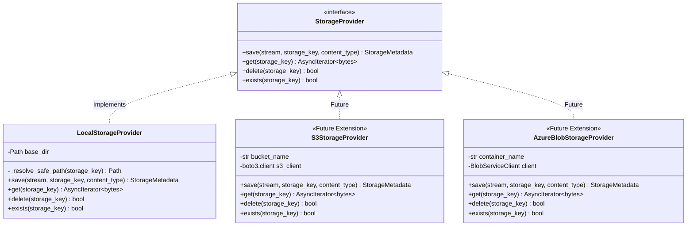

# Storage Engine Architecture & Multi-Cloud Provider Abstraction

This document details the storage architecture, filesystem isolation policies, and cloud integration roadmap implemented in Phase 5 of the Enterprise RAG AI Assistant.

---

## 1. Modular Storage Engine Abstraction

The storage engine decouples enterprise document handling and lifecycle operations from physical storage backends.



### StorageMetadata Contract
Every persistent object in storage returns standardized metadata:
- `storage_key`: Unique canonical server-generated identifier.
- `file_size_bytes`: Integer byte count.
- `content_type`: Verified canonical MIME type (e.g. `application/pdf`).
- `checksum_sha256`: Lowercase 64-character hexadecimal SHA-256 digest.
- `stored_at`: UTC timestamp of persistence.

---

## 2. Local Storage Provider Security & Isolation

### Path Traversal Defense
In `LocalStorageProvider`:
1. Storage keys are stripped of leading slashes.
2. The candidate path is computed: `(self.base_dir / clean_key).resolve()`.
3. Strict containment check:
   ```python
   candidate_path.relative_to(self.base_dir)
   ```
   If any key attempts to break outside the configured storage directory (e.g. `../../etc/shadow` or directory hopping), it immediately triggers a critical security event and raises a `ValueError`.

### Private Storage & No Direct File Exposure
- Storage files are never placed inside public web server roots or static asset directories.
- Public APIs **never expose physical filesystem paths** (such as `E:\enterprise-rag-ai-assistant\storage_data\...`).
- External API consumers receive only the opaque `document_id` and sanitized `file_name`. The physical location is strictly an internal database implementation detail stored in `file_path`.

---

## 3. Storage Key Partitioning & Versioning

Storage keys follow an explicit tenant-partitioned layout:
```
tenants/{organization_id}/documents/{document_id}/{version_id}_{sanitized_filename}
```

### Advantages
1. **Tenant Isolation**: All assets belonging to a tenant live beneath `tenants/{organization_id}/`, facilitating tenant-level storage quotas, bulk exports, or complete tenant data wiping.
2. **Immutable Version Snapshots**: When a document is updated with a new version, a new `version_id` UUID key is generated. Historical versions are never overwritten in-place, preserving audit trails and previous RAG citations.
3. **Collision Resistance**: Because both `document_id` and `version_id` are UUID4 values, concurrent uploads with identical filenames can never overwrite or corrupt each other.

---

## 4. Multi-Cloud Roadmap (AWS S3 & Azure Blob Storage)

The `StorageProvider` abstraction enables switching storage providers simply by setting the `STORAGE_PROVIDER` environment variable without altering any business logic or API contracts:

### Amazon S3 (`STORAGE_PROVIDER="s3"`)
- Uses AWS SDK (`aioboto3` or `boto3`).
- Server-Side Encryption with KMS (`SSE-KMS` or `SSE-S3`).
- Bucket policies enforce `aws:SecureTransport` (HTTPS only).
- Object tagging by `OrganizationId` and `DepartmentId` for AWS Cost Allocation.

### Azure Blob Storage (`STORAGE_PROVIDER="azure"`)
- Uses Azure SDK (`azure-storage-blob`).
- Container per tenant or prefix-partitioned standard container.
- Customer-managed encryption keys (Azure Key Vault).
